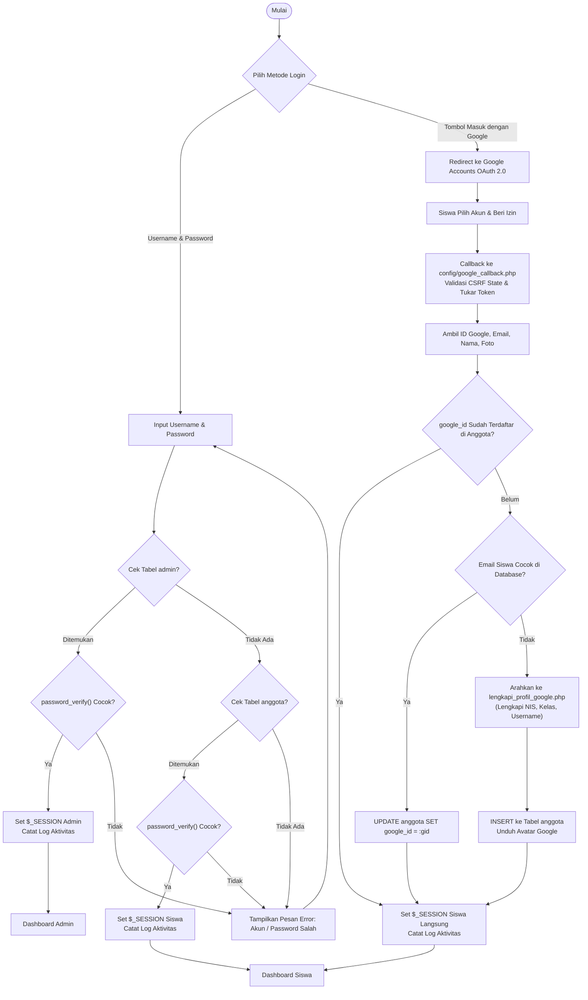
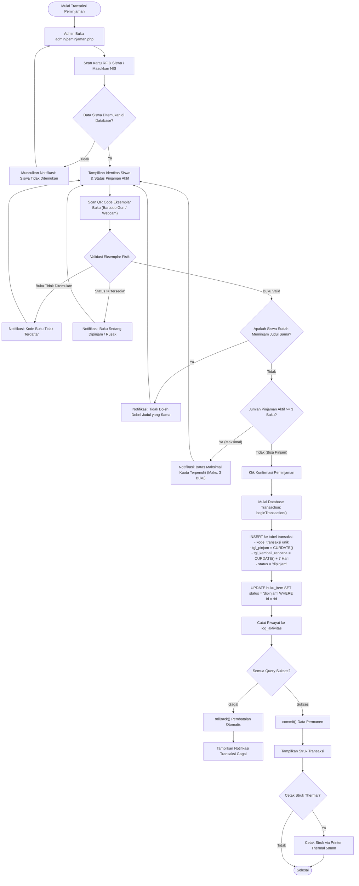
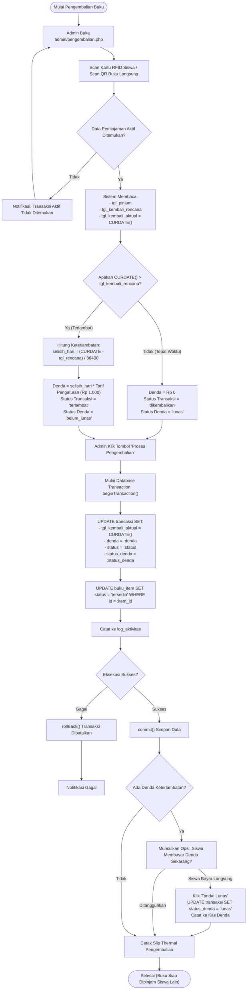
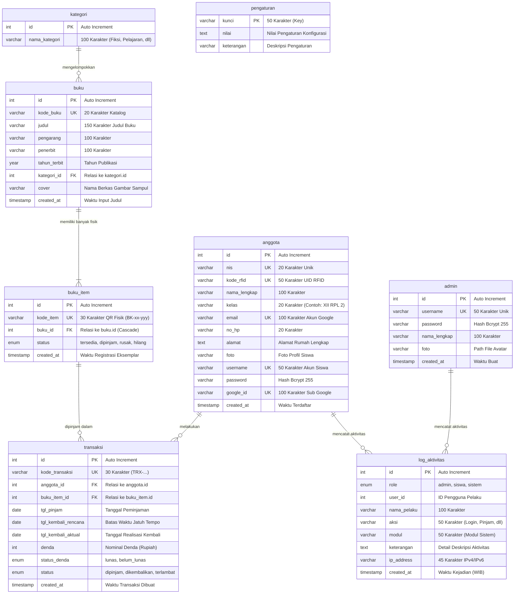
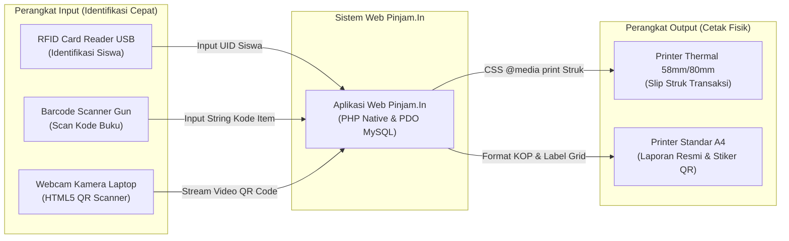

# DRAFT LAPORAN UJI KOMPETENSI KEAHLIAN (UKK)
## PROGRAM KEAHLIAN REKAYASA PERANGKAT LUNAK (RPL)
### TAHUN PELAJARAN 2025 / 2026

---

# 1. COVER

```text
                     LAPORAN PRAKTIK UJI KOMPETENSI KEAHLIAN
                   REKAYASA PERANGKAT LUNAK (RPL) TAHUN 2026

      RANCANG BANGUN APLIKASI PERPUSTAKAAN DIGITAL BERBASIS WEB
      TERINTEGRASI SISTEM IDENTIFIKASI RFID DAN SCANNER QR CODE
                              "PINJAM.IN"
                 PADA SMK NEGERI 1 PANYINGKIRAN


                                  [ LOGO ]
                            SMKN 1 PANYINGKIRAN


                                Disusun Oleh:
                            MUHAMMAD FARID MALIK
                                NIS: 2425123
                               KELAS: XII RPL 2


                    PEMERINTAH DAERAH PROVINSI JAWA BARAT
                            DINAS PENDIDIKAN
                 CABANG DINAS PENDIDIKAN WILAYAH IX
                       SMK NEGERI 1 PANYINGKIRAN
             Jl. Kirapandawa No. 46, Liangjulang, Kec. Panyingkiran,
                          Kabupaten Majalengka, Jawa Barat 45459
                                  2026
```

---

# 2. KATA PENGANTAR

Puji dan syukur penulis panjatkan ke hadirat Allah SWT atas limpahan rahmat, taufik, serta hidayah-Nya, sehingga penulis dapat menyelesaikan penulisan Laporan Praktik Uji Kompetensi Keahlian (UKK) yang berjudul **"Rancang Bangun Aplikasi Perpustakaan Digital Berbasis Web Terintegrasi Sistem Identifikasi RFID dan Scanner QR Code (Pinjam.In) pada SMK Negeri 1 Panyingkiran"** dengan baik dan tepat waktu.

Laporan ini disusun sebagai salah satu syarat mutlak guna menyelesaikan pendidikan pada Kompetensi Keahlian Rekayasa Perangkat Lunak (RPL) di SMK Negeri 1 Panyingkiran Tahun Pelajaran 2025/2026, sekaligus sebagai pertanggungjawaban karya proyek perangkat lunak mandiri yang telah dirancang, diimplementasikan, dan diuji.

Dalam proses perancangan sistem hingga terselesaikannya penulisan laporan ini, penulis mendapatkan banyak bimbingan, arahan, dan dukungan moril dari berbagai pihak. Oleh karena itu, penulis ingin menyampaikan ucapan terima kasih yang tulus dan penghargaan setinggi-tingginya kepada:

1. **Bapak/Ibu Kepala SMK Negeri 1 Panyingkiran**, yang senantiasa memfasilitasi sarana dan prasarana pendidikan teknologi yang unggul.
2. **Bapak/Ibu Penguji Internal dan Penguji Eksternal (Industri)**, yang telah meluangkan waktu untuk menguji, membimbing, dan memvalidasi kelayakan proyek perangkat lunak ini.
3. **Bapak/Ibu Guru Produktif Rekayasa Perangkat Lunak SMK Negeri 1 Panyingkiran**, atas dedikasi dan transfer ilmu pengetahuan seputar pemrograman web, basis data, dan rekayasa sistem.
4. **Kedua Orang Tua dan Keluarga Tercinta**, yang tiada henti memanjatkan doa, memberikan dorongan motivasi, serta pengorbanan materiel maupun spiritual.
5. **Rekan-rekan seperjuangan Kelas XII RPL 2**, atas kerja sama, diskusi, dan solidaritas selama proses pengerjaan proyek UKK ini berlangsung.

Penulis menyadari bahwa sistem maupun laporan ini masih memiliki ruang untuk penyempurnaan di masa mendatang. Oleh sebab itu, kritik dan saran yang konstruktif sangat diharapkan demi pengembangan aplikasi ke arah yang lebih baik. Semoga karya ini dapat memberikan manfaat nyata bagi kemajuan sistem informasi di lingkungan SMK Negeri 1 Panyingkiran serta menambah literatur di bidang Rekayasa Perangkat Lunak.

<div align="right">
  Majalengka, Februari 2026<br><br><br>
  <b>Muhammad Farid Malik</b><br>
  NIS. 2425123
</div>

---

# 3. DAFTAR ISI

- **LEMBAR PENGESAHAN SEKOLAH & PENGUJI**
- **KATA PENGANTAR**
- **DAFTAR ISI**
- **DAFTAR GAMBAR & FLOWCHART**
- **DAFTAR TABEL**
- **BAB I: DESKRIPSI PROJEK**
  - 1.1 Latar Belakang Masalah
  - 1.2 Tujuan Aplikasi
  - 1.3 Fungsi dan Fitur Utama
  - 1.4 Teknologi yang Digunakan
  - 1.5 Identifikasi Pengguna Aplikasi (User Role)
- **BAB II: FLOWCHART SISTEM**
  - 2.1 Flowchart Autentikasi Pengguna & Multi-Role Login
  - 2.2 Flowchart Transaksi Peminjaman Meja Sirkulasi
  - 2.3 Flowchart Transaksi Pengembalian & Kalkulasi Denda
- **BAB III: PERANCANGAN DATABASE**
  - 3.1 Entity Relationship Diagram (ERD)
  - 3.2 Struktur & Spesifikasi Tabel Basis Data
    - 3.2.1 Tabel `admin`
    - 3.2.2 Tabel `anggota`
    - 3.2.3 Tabel `buku`
    - 3.2.4 Tabel `buku_item`
    - 3.2.5 Tabel `kategori`
    - 3.2.6 Tabel `transaksi`
    - 3.2.7 Tabel `pengaturan`
    - 3.2.8 Tabel `log_aktivitas`
- **BAB IV: IMPLEMENTASI ANTARMUKA PENGGUNA (USER INTERFACE)**
  - 4.1 Tampilan Publik & Siswa
  - 4.2 Tampilan Administrator Perpustakaan
- **BAB V: IMPLEMENTASI PERANGKAT KERAS PENDUKUNG**
  - 5.1 Barcode Scanner Gun (USB HID)
  - 5.2 Kamera Webcam (HTML5 Realtime QR Reader)
  - 5.3 Printer Thermal (Slip Bukti Transaksi ESC/POS)
  - 5.4 Printer Desktop Standar (Laporan & Label Stiker QR)
  - 5.5 RFID Card Reader (Identifikasi Kartu Pelajar Cepat)
- **BAB VI: PENUTUP**
  - 6.1 Kesimpulan
  - 6.2 Saran Pengembangan
- **LAMPIRAN**

---

# 4. DESKRIPSI PROJEK

### 4.1 Latar Belakang Masalah
Perpustakaan sekolah merupakan jantung sumber belajar dan jendela literasi bagi seluruh warga pendidikan di SMK Negeri 1 Panyingkiran. Namun dalam operasional kesehariannya, sistem pelayanan sirkulasi yang masih bersifat manual atau semi-digital berbasis spreadsheet sering menghadapi kendala nyata:
1. **Antrean Meja Sirkulasi yang Menumpuk**: Pada jam istirahat sekolah yang berdurasi singkat (15–30 menit), puluhan siswa berkerumun untuk meminjam buku. Petugas perpustakaan harus mencari data siswa secara manual, mencatat kode buku satu demi satu ke buku besar, dan memverifikasi batas pinjaman. Proses ini memakan waktu 2–4 menit per transaksi.
2. **Ketiadaan Pelacakan Eksemplar Fisik**: Judul buku yang sama di perpustakaan umumnya memiliki 5 hingga 20 eksemplar fisik. Sistem konvensional yang hanya mencatat "Judul Buku" tidak mampu membedakan eksemplar mana yang rusak, hilang, atau sedang berada di tangan siswa tertentu.
3. **Keterlambatan dan Pengawasan Kas Denda**: Perhitungan denda harian yang dihitung manual rawan terjadi kekeliruan pembukuan serta kebocoran kas perpustakaan. Siswa pun kerap lupa batas tanggal pengembalian karena tidak memiliki kartu pengingat digital.
4. **Kebutuhan Aksesibilitas Modern**: Generasi siswa saat ini terbiasa dengan kemudahan *Single Sign-On* (SSO) akun Google sekolah serta katalog online yang responsif melalui smartphone tanpa harus datang ke rak buku hanya untuk mengecek ketersediaan stok.

Berdasarkan permasalahan di atas, dirancanglah **Pinjam.In**, sebuah sistem perpustakaan digital terintegrasi yang menggabungkan aplikasi web modular dengan 5 perangkat keras operasional (RFID Reader, Barcode/QR Scanner, Webcam, Thermal Printer, dan Printer Standar) untuk mewujudkan konsep *Smart School Library* yang akuntabel, cepat, dan presisi.

### 4.2 Tujuan Aplikasi
Pengembangan aplikasi **Pinjam.In** bertujuan untuk:
1. **Mempercepat Pelayanan Meja Sirkulasi**: Memangkas waktu pencatatan transaksi dari hitungan menit menjadi di bawah 5 detik per transaksi melalui teknologi *Tap RFID* kartu pelajar dan pemindaian cepat QR Code eksemplar buku.
2. **Menjamin Akurasi Inventaris Koleksi Fisik**: Mengimplementasikan model pendataan buku berbasis fisik (1 judul memiliki banyak `buku_item` berkode QR unik).
3. **Meningkatkan Transparansi Finansial Kas Denda**: Mengotomatisasi kalkulasi denda keterlambatan berjalan serta status pelunasan kas secara transparan.
4. **Menyediakan Layanan Mandiri (*Self-Service*) Bagi Siswa**: Memudahkan siswa menelusuri katalog buku, ketersediaan rak, status peminjaman aktif, serta integrasi login instan via akun Google.
5. **Mempermudah Rekapitulasi & Pelaporan Resmi**: Menyediakan fasilitas cetak dokumen resmi ber-KOP sekolah, format cetak struk kasir thermal, serta ekspor file Microsoft Excel (.xls) berstandar industri.

### 4.3 Fungsi dan Fitur Utama
Aplikasi Pinjam.In dilengkapi fitur-fitur komprehensif sebagai berikut:
- **Autentikasi Ganda & Keamanan**:
  - Dukungan login username/password dengan hashing `PASSWORD_BCRYPT`.
  - Integrasi **Google OAuth 2.0 Client** untuk login mandiri siswa dengan email Google.
  - Alur *Onboarding* pendaftaran akun siswa baru otomatis dari data profil Google.
  - Fitur perlindungan Session Hijacking dan token CSRF State.
  - Fitur Reset Password siswa ke default (NIS) oleh Administrator dalam sekali klik.
- **Manajemen Inventaris Buku & Eksemplar (Multi-Copies)**:
  - Pencatatan metadata bibliografi lengkap (Judul, Pengarang, Penerbit, Tahun Terbit, Kategori).
  - Generator eksemplar otomatis dengan format kode unik (misal: `BK-17-001`, `BK-17-002`).
  - Unggah cover buku dengan validasi tipe file (JPG, PNG, WebP) dan kompresi visual.
  - Generator kode QR individual per buku fisik yang siap dicetak sebagai stiker label rak.
  - Impor data buku massal dari format berkas CSV.
- **Manajemen Siswa & Pairing Kartu RFID Fisik**:
  - Pendataan anggota siswa lengkap (NIS, Nama, Kelas, No. HP, Alamat, Foto Profil).
  - Fitur *Tap Pairing RFID* untuk menautkan nomor kartu UID fisik langsung ke akun siswa.
- **Layanan Sirkulasi Cepat (Peminjaman & Pengembalian)**:
  - Identifikasi peminjam instan melalui Tap Kartu RFID atau input NIS.
  - Pemindaian buku fisik via Barcode Gun maupun Webcam kamera laptop secara realtime.
  - Validasi sistem otomatis: pemeriksaan status stok fisik, pembatasan kuota maksimal (3 buku), dan pencegahan peminjaman ganda untuk judul yang sama.
  - Penentuan tanggal kembali otomatis (H+7 hari).
  - Deteksi keterlambatan otomatis dan kalkulasi denda harian kas (Rp 1.000/hari).
  - Manajemen status denda (*Lunas* vs *Belum Lunas*) serta pencatatan setoran kas denda.
- **Pencarian & Pagination Server-Side Modern**:
  - Navigasi halaman cepat (*server-side limit/offset*) dengan komponen responsif.
  - Preservasi parameter query string (pencarian kata kunci, filter kategori, status, rentang tanggal tetap aktif saat berpindah halaman).
- **Pelaporan & Ekspor Berkas**:
  - Ekspor laporan sirkulasi ke spreadsheet **Microsoft Excel (.xls)** dengan tata letak resmi, KOP sekolah, border rapi, badge warna, dan format mata uang rupiah.
  - Cetak slip transaksi mini menggunakan printer thermal (58mm/80mm).
  - Cetak laporan arsip A4 berstandar dinas dengan jam WIB dan tanda tangan pengesahan.
- **Audit Trail & Log Aktivitas**:
  - Pencatatan seluruh aksi pengguna (login, tambah, ubah, hapus data, transaksi, pelunasan denda) lengkap dengan IP Address dan timestamp waktu WIB.

### 4.4 Teknologi yang Digunakan
| Komponen | Spesifikasi & Teknologi | Alasan Pemilihan |
| :--- | :--- | :--- |
| **Bahasa Pemrograman Backend** | PHP 8.2 (Native Modular) | Ringan, kompatibel dengan seluruh web server sekolah, tanpa overhead vendor luar. |
| **Akses Basis Data** | **PDO (PHP Data Objects)** | Mendukung *Prepared Statements* terparameterisasi untuk proteksi mutlak dari serangan **SQL Injection**. |
| **Sistem Basis Data (RDBMS)** | MariaDB 10.4 / MySQL | Mendukung relasi Foreign Key (Cascading) dan transaksi atomik ACID (`beginTransaction`, `commit`, `rollBack`). |
| **Bahasa Antarmuka Frontend** | HTML5, CSS3 Murni, Vanilla JS | Performa rendering instan, responsif di layar desktop maupun smartphone. |
| **Tipografi & Ikon** | Plus Jakarta Sans, JetBrains Mono, SVG | Menampilkan antarmuka modern setara aplikasi industri SaaS masa kini. |
| **Library Pemindai QR** | HTML5-QRCode (Webcam API) | Membaca kode QR secara realtime langsung dari web browser tanpa instalasi plugin. |
| **Protokol Autentikasi** | Google Identity Service OAuth 2.0 | Memungkinkan siswa masuk dengan akun Google sekolah secara aman dan praktis. |
| **Web Server Lokal** | Apache 2.4 (XAMPP Environment) | Lingkungan pengujian standar kompetensi UKK SMK. |

### 4.5 Pengguna Aplikasi (User Role)
1. **Administrator Perpustakaan (Pustakawan)**:
   - Memiliki wewenang mengelola katalog buku dan pencetakan stiker QR label.
   - Mengelola anggota dan melakukan pairing kartu RFID siswa.
   - Melayani meja sirkulasi peminjaman, pengembalian, dan kas denda.
   - Mengunduh rekapitulasi laporan Excel dan mencetak lembar verifikasi arsip.
   - Memantau log aktivitas keamanan sistem.
2. **Siswa (Anggota Perpustakaan)**:
   - Mendaftar akun mandiri atau masuk melalui Single Sign-On Google.
   - Menjelajahi katalog buku perpustakaan lengkap dengan filter kategori interaktif.
   - Memeriksa jumlah eksemplar yang masih tersedia di rak secara realtime.
   - Memantau riwayat peminjaman aktif, batas tanggal jatuh tempo, dan rincian denda.
   - Memperbarui data profil pribadi dan foto kartu anggota.

---

# 5. FLOWCHART SISTEM

### 5.1 Flowchart Proses Utama: Autentikasi & Multi-Role Login
Diagram alir proses autentikasi mencakup dua opsi login: kredensial username/password tradisional dan Single Sign-On Google OAuth 2.0.



---

### 5.2 Flowchart Proses Utama: Transaksi Peminjaman Buku di Meja Sirkulasi
Diagram alir proses peminjaman yang mengintegrasikan pemindaian RFID/NIS dan kode QR buku fisik dengan validasi kuota pinjaman.



---

### 5.3 Flowchart Proses Utama: Transaksi Pengembalian Buku & Perhitungan Denda
Diagram alir pengembalian buku fisik di meja sirkulasi yang mengkalkulasi selisih hari keterlambatan dan pembukuan kas denda.



---

# 6. PERANCANGAN DATABASE

### 6.1 Entity Relationship Diagram (ERD)
Database sistem bernama `pinjam_in` dirancang dengan normalisasi tingkat ketiga (3NF) guna menjamin konsistensi data, relasi foreign key yang kokoh, dan integritas referensial.



---

### 6.2 Struktur & Spesifikasi Tabel Basis Data

#### 1. Tabel `admin`
Menyimpan akun administrator atau staf pustakawan yang berwenang mengelola sistem.
| No | Field | Tipe Data | Null | Kunci | Keterangan |
|---|---|---|---|---|---|
| 1 | `id` | INT(11) | NO | PK (AI) | Primary Key ID Admin |
| 2 | `username` | VARCHAR(50) | NO | UNIQUE | Username akun staf untuk login |
| 3 | `password` | VARCHAR(255) | NO | - | Password terenkripsi algoritma Bcrypt |
| 4 | `nama_lengkap` | VARCHAR(100) | NO | - | Nama lengkap petugas perpustakaan |
| 5 | `foto` | VARCHAR(255) | YES | - | Nama berkas foto profil admin |
| 6 | `created_at` | TIMESTAMP | NO | - | Waktu akun didaftarkan (Default CURRENT_TIMESTAMP) |

#### 2. Tabel `anggota`
Menyimpan identitas lengkap siswa yang terdaftar sebagai anggota perpustakaan.
| No | Field | Tipe Data | Null | Kunci | Keterangan |
|---|---|---|---|---|---|
| 1 | `id` | INT(11) | NO | PK (AI) | Primary Key ID Anggota Siswa |
| 2 | `nis` | VARCHAR(20) | NO | UNIQUE | Nomor Induk Siswa Nasional / Sekolah |
| 3 | `kode_rfid` | VARCHAR(50) | YES | UNIQUE | Kode unik kartu RFID fisik hasil tap |
| 4 | `nama_lengkap` | VARCHAR(100) | NO | - | Nama lengkap siswa |
| 5 | `kelas` | VARCHAR(20) | NO | - | Rombongan belajar siswa (misal: XII RPL 2) |
| 6 | `email` | VARCHAR(100) | YES | UNIQUE | Alamat surel siswa (Sinkronisasi Google) |
| 7 | `no_hp` | VARCHAR(20) | YES | - | Nomor WhatsApp / telepon aktif siswa |
| 8 | `alamat` | TEXT | YES | - | Alamat domisili lengkap siswa |
| 9 | `foto` | VARCHAR(255) | YES | - | Nama berkas foto profil siswa di server |
| 10 | `username` | VARCHAR(50) | NO | UNIQUE | Username untuk login mandiri portal siswa |
| 11 | `password` | VARCHAR(255) | NO | - | Password terenkripsi algoritma Bcrypt |
| 12 | `google_id` | VARCHAR(100) | YES | UNIQUE | ID unik pengguna resmi dari Google API |
| 13 | `created_at` | TIMESTAMP | NO | - | Waktu pendaftaran anggota |

#### 3. Tabel `buku`
Menyimpan data katalog referensi dan judul bibliografi buku.
| No | Field | Tipe Data | Null | Kunci | Keterangan |
|---|---|---|---|---|---|
| 1 | `id` | INT(11) | NO | PK (AI) | Primary Key ID Judul Buku |
| 2 | `kode_buku` | VARCHAR(20) | NO | UNIQUE | Kode katalog buku |
| 3 | `judul` | VARCHAR(150) | NO | - | Judul lengkap karya pustaka |
| 4 | `pengarang` | VARCHAR(100) | YES | - | Nama penulis / pengarang buku |
| 5 | `penerbit` | VARCHAR(100) | YES | - | Nama badan penerbit |
| 6 | `tahun_terbit` | YEAR(4) | YES | - | Tahun buku diterbitkan |
| 7 | `kategori_id` | INT(11) | YES | FK | Foreign Key ke `kategori.id` (ON DELETE SET NULL) |
| 8 | `cover` | VARCHAR(255) | YES | - | Nama file gambar cover di `uploads/covers/` |
| 9 | `created_at` | TIMESTAMP | NO | - | Waktu buku ditambahkan ke koleksi |

#### 4. Tabel `buku_item`
Menyimpan rekaman fisik per eksemplar buku di rak perpustakaan.
| No | Field | Tipe Data | Null | Kunci | Keterangan |
|---|---|---|---|---|---|
| 1 | `id` | INT(11) | NO | PK (AI) | Primary Key ID Eksemplar |
| 2 | `kode_item` | VARCHAR(30) | NO | UNIQUE | Kode QR individual (misal: `BK-17-001`) |
| 3 | `buku_id` | INT(11) | NO | FK | Foreign Key ke `buku.id` (ON DELETE CASCADE) |
| 4 | `status` | ENUM | NO | - | `'tersedia'`, `'dipinjam'`, `'rusak'`, `'hilang'` |
| 5 | `created_at` | TIMESTAMP | NO | - | Waktu eksemplar dibuat |

#### 5. Tabel `kategori`
Mengelompokkan koleksi buku berdasarkan bidang keilmuan.
| No | Field | Tipe Data | Null | Kunci | Keterangan |
|---|---|---|---|---|---|
| 1 | `id` | INT(11) | NO | PK (AI) | Primary Key ID Kategori |
| 2 | `nama_kategori` | VARCHAR(100) | NO | - | Nama kategori (Fiksi, Pelajaran, dsb.) |

#### 6. Tabel `transaksi`
Mencatat seluruh sirkulasi peminjaman, pengembalian, status denda, dan tanggal jatuh tempo.
| No | Field | Tipe Data | Null | Kunci | Keterangan |
|---|---|---|---|---|---|
| 1 | `id` | INT(11) | NO | PK (AI) | Primary Key ID Transaksi |
| 2 | `kode_transaksi` | VARCHAR(30) | NO | UNIQUE | Kode unik transaksi peminjaman |
| 3 | `anggota_id` | INT(11) | NO | FK | Foreign Key ke `anggota.id` |
| 4 | `buku_item_id` | INT(11) | NO | FK | Foreign Key ke `buku_item.id` |
| 5 | `tgl_pinjam` | DATE | NO | - | Tanggal buku dipinjam |
| 6 | `tgl_kembali_rencana` | DATE | NO | - | Batas tanggal pengembalian (H+7 hari) |
| 7 | `tgl_kembali_aktual` | DATE | YES | - | Tanggal nyata saat buku dikembalikan |
| 8 | `denda` | INT(11) | NO | - | Besaran denda keterlambatan (Default 0) |
| 9 | `status_denda` | ENUM | NO | - | `'lunas'`, `'belum_lunas'` |
| 10 | `status` | ENUM | NO | - | `'dipinjam'`, `'dikembalikan'`, `'terlambat'` |
| 11 | `created_at` | TIMESTAMP | NO | - | Waktu transaksi dibuat di sistem |

#### 7. Tabel `pengaturan`
Menyimpan konfigurasi parameter dinamis perpustakaan sekolah.
| No | Field | Tipe Data | Null | Kunci | Keterangan |
|---|---|---|---|---|---|
| 1 | `kunci` | VARCHAR(50) | NO | PK | Kunci konfigurasi unik (Primary Key) |
| 2 | `nilai` | TEXT | NO | - | Nilai setting (contoh tarif denda: 1000) |
| 3 | `keterangan` | VARCHAR(255) | YES | - | Deskripsi peruntukan konfigurasi |

#### 8. Tabel `log_aktivitas`
Menyimpan rekaman audit (*audit trail*) untuk keamanan dan pemantauan sistem.
| No | Field | Tipe Data | Null | Kunci | Keterangan |
|---|---|---|---|---|---|
| 1 | `id` | INT(11) | NO | PK (AI) | Primary Key ID Log |
| 2 | `role` | ENUM | NO | - | `'admin'`, `'siswa'`, `'sistem'` |
| 3 | `user_id` | INT(11) | YES | - | ID pengguna bersangkutan |
| 4 | `nama_pelaku` | VARCHAR(100) | NO | - | Nama pengguna yang melakukan aksi |
| 5 | `aksi` | VARCHAR(50) | NO | - | Jenis aksi (Login, Tambah, Edit, Hapus, Lunasi) |
| 6 | `modul` | VARCHAR(50) | NO | - | Modul terkait (Buku, Sirkulasi, Profil, dsb.) |
| 7 | `keterangan` | TEXT | NO | - | Uraian detail catatan log aktivitas |
| 8 | `ip_address` | VARCHAR(45) | YES | - | Alamat IP perangkat pengguna (IPv4/IPv6) |
| 9 | `created_at` | TIMESTAMP | NO | - | Waktu aktivitas tercatat (WIB) |

---

# 7. TAMPILAN PUBLIC (SISWA & UMUM)

Berikut adalah dokumentasi antarmuka pada area publik dan portal siswa:

### 7.1 Halaman Beranda Publik (`index.php`)
- **Fungsi**: Halaman awal yang menyambut pengunjung perpustakaan, menampilkan katalog unggulan, statistik koleksi, serta panduan singkat tata cara peminjaman buku sekolah.
- **Elemen Penting**: Header interaktif, pencarian katalog instan, tombol pintas login portal siswa/admin, dan kartu koleksi buku populer.
> *(Tempelkan Screenshot Tampilan `index.php` pada area ini saat menyusun dokumen di Microsoft Word)*

### 7.2 Halaman Autentikasi Pengguna (`login.php`)
- **Fungsi**: Gerbang masuk tunggal untuk Administrator maupun Siswa dengan sistem auto-routing berdasarkan role.
- **Elemen Penting**: Input username/NIS, input password, tombol "Masuk dengan Google" resmi, serta tautan ke halaman bantuan lupa password dan registrasi siswa mandiri.
> *(Tempelkan Screenshot Tampilan `login.php` pada area ini)*

### 7.3 Halaman Pendaftaran Siswa Mandiri (`daftar.php`)
- **Fungsi**: Form registrasi akun bagi siswa yang belum terdaftar di sistem perpustakaan.
- **Elemen Penting**: Input NIS unik, nama lengkap, pilihan kelas (X, XI, XII RPL), nomor WhatsApp, username, dan konfirmasi password.
> *(Tempelkan Screenshot Tampilan `daftar.php` pada area ini)*

### 7.4 Halaman Onboarding Google SSO (`lengkapi_profil_google.php`)
- **Fungsi**: Formulir verifikasi bagi siswa yang baru pertama kali login menggunakan akun Google. Nama dan surel diambil otomatis dari Google API, siswa cukup mengonfirmasi kesesuaian nama dan mengisi NIS sekolah.
- **Elemen Penting**: Avatar foto Google terverifikasi, form NIS, pilihan kelas, dan tombol simpan profil anggota.
> *(Tempelkan Screenshot Tampilan `lengkapi_profil_google.php` pada area ini)*

### 7.5 Halaman Dashboard Siswa (`siswa/dashboard.php`)
- **Fungsi**: Pusat kendali siswa yang merangkum kartu informasi anggota digital, buku yang sedang dipinjam beserta sisa hari jatuh tempo, total buku yang pernah dibaca, dan rekomendasi buku baru.
- **Elemen Penting**: Kartu Pelajar Digital ber-QR Code, peringatan batas tanggal kembali, dan widget status sirkulasi pribadi.
> *(Tempelkan Screenshot Tampilan `siswa/dashboard.php` pada area ini)*

### 7.6 Halaman Katalog Buku Siswa (`siswa/daftar_buku.php`)
- **Fungsi**: Antarmuka bagi siswa untuk menjelajahi seluruh koleksi buku sekolah secara mandiri.
- **Elemen Penting**: Bilah pencarian kata kunci, pil filter kategori (Fiksi, Non-Fiksi, Pelajaran, Komik), kartu buku 3D dengan indikator ketersediaan stok fisik di rak (`X dari Y tersedia`), pagination server-side, serta modal popup rincian bibliografi buku.
> *(Tempelkan Screenshot Tampilan `siswa/daftar_buku.php` pada area ini)*

### 7.7 Halaman Riwayat Transaksi Siswa (`siswa/riwayat.php`)
- **Fungsi**: Rekapan lengkap seluruh buku yang pernah dipinjam siswa beserta status denda dan keterangan pengembalian tepat waktu/terlambat.
- **Elemen Penting**: Badge status (`Dipinjam`, `Dikembalikan`, `Terlambat`), tanggal pinjam, batas waktu, tanggal kembali riil, dan nominal denda.
> *(Tempelkan Screenshot Tampilan `siswa/riwayat.php` pada area ini)*

---

# 8. TAMPILAN ADMIN

Berikut adalah dokumentasi antarmuka kerja Administrator / Staf Perpustakaan:

### 8.1 Dashboard Utama Administrator (`admin/dashboard.php`)
- **Fungsi**: Memantau metrik performa operasional perpustakaan sekolah dalam satu layar terpadu.
- **Elemen Penting**: Metrik ringkas (Total Judul Buku, Total Fisik Eksemplar, Anggota Siswa Aktif, Peminjaman Sedang Berjalan, Transaksi Terlambat), grafik tren sirkulasi bulanan, dan tabel peminjaman terkini.
> *(Tempelkan Screenshot Tampilan `admin/dashboard.php` pada area ini)*

### 8.2 Manajemen Koleksi Buku (`admin/buku.php`)
- **Fungsi**: Mengelola master judul buku, unggah file cover buku, filter kategori server-side, pagination, serta aksi modal tambah/edit/hapus buku.
- **Elemen Penting**: Tabel judul buku, metrik stok eksemplar, tombol "Kelola Eksemplar", tombol "Cetak Stiker QR", dan filter chip kategori.
> *(Tempelkan Screenshot Tampilan `admin/buku.php` pada area ini)*

### 8.3 Manajemen Eksemplar Fisik & Cetak Stiker Label QR (`admin/buku_item.php` & `config/generate_qr.php`)
- **Fungsi**: Mengelola stok fisik individual per buku di rak perpustakaan dan mencetak stiker barcode/QR code fisik.
- **Elemen Penting**: Daftar kode item (`BK-xx-yyy`), status fisik per buku (`tersedia`, `dipinjam`, `rusak`, `hilang`), dan lembar cetak stiker label siap gunting untuk ditempel pada punggung buku.
> *(Tempelkan Screenshot Tampilan `admin/buku_item.php` & `config/generate_qr.php` pada area ini)*

### 8.4 Manajemen Anggota & Fitur Pairing Kartu RFID (`admin/anggota.php`)
- **Fungsi**: Pendataan seluruh siswa, reset password akun ke default (NIS), dan menautkan kartu fisik RFID siswa.
- **Elemen Penting**: Modal interaktif "Tap Kartu RFID Siswa" yang otomatis mendeteksi UID kartu USB, filter chip status (Bebas Pinjaman, Meminjam, RFID Aktif), dan pagination data siswa.
> *(Tempelkan Screenshot Tampilan `admin/anggota.php` pada area ini)*

### 8.5 Meja Sirkulasi Peminjaman Buku (`admin/peminjaman.php`)
- **Fungsi**: Halaman operasional utama kasir perpustakaan untuk memproses peminjaman buku oleh siswa dalam hitungan detik.
- **Elemen Penting**: Input scan kartu RFID siswa / NIS, panel identitas siswa aktif, pemindai Barcode Gun / Webcam HTML5, validasi kuota 3 buku, dan tombol cetak struk thermal peminjaman.
> *(Tempelkan Screenshot Tampilan `admin/peminjaman.php` pada area ini)*

### 8.6 Meja Sirkulasi Pengembalian Buku (`admin/pengembalian.php`)
- **Fungsi**: Memproses pengembalian buku fisik, kalkulasi selisih hari denda otomatis, dan pencatatan kas denda.
- **Elemen Penting**: Tombol "Kembalikan", label peringatan telat, kalkulator estimasi denda berjalan, konfirmasi pelunasan kas denda, dan cetak struk thermal pengembalian.
> *(Tempelkan Screenshot Tampilan `admin/pengembalian.php` pada area ini)*

### 8.7 Riwayat Transaksi & Pelunasan Kas Denda (`admin/transaksi.php`)
- **Fungsi**: Arsip menyeluruh seluruh sirkulasi perpustakaan dengan filter tanggal dari-sampai, kata kunci, dan status.
- **Elemen Penting**: Tombol "Tandai Lunas" denda, badge status sirkulasi, pagination responsif, dan tombol cetak arsip.
> *(Tempelkan Screenshot Tampilan `admin/transaksi.php` pada area ini)*

### 8.8 Ekspor Rekapitulasi Laporan Excel (.xls) (`admin/export_transaksi.php`)
- **Fungsi**: Mengunduh seluruh rekap sirkulasi ke spreadsheet Microsoft Excel berformat rapi dan profesional.
- **Elemen Penting**: KOP resmi SMKN 1 Panyingkiran, lebar kolom pas (mencegah teks tanggal `########`), format mata uang Rupiah standar akuntansi, zebra striping tabel, serta ringkasan total uang kas denda terkumpul.
> *(Tempelkan Screenshot Hasil Ekspor Excel pada area ini)*

### 8.9 Log Aktivitas Sistem (`admin/log_aktivitas.php`)
- **Fungsi**: Rekam jejak audit keamanan sistem perpustakaan yang mencatat waktu kejadian, aktor pelaku, role, jenis aksi, modul, deskripsi aktivitas, dan alamat IP.
> *(Tempelkan Screenshot Tampilan `admin/log_aktivitas.php` pada area ini)*

---

# 9. IMPLEMENTASI ALAT PENDUKUNG (HARDWARE PERIPHERAL)

Keunggulan utama aplikasi **Pinjam.In** adalah kemampuannya berkomunikasi secara *seamless* dengan 5 jenis perangkat keras tanpa memerlukan instalasi driver perangkat lunak yang rumit di sisi klien:



### 9.1 Barcode Scanner Gun (USB Handheld)
- **Tipe & Antarmuka**: Barcode / 2D QR Scanner Gun dengan koneksi USB (Plug and Play).
- **Mekanisme Kerja**: Bekerja dalam mode **HID (Human Interface Device) Keyboard Wedge**. Ketika scanner menembakkan laser/sensor optik ke kode QR stiker buku fisik, scanner mendekode simbol menjadi untaian teks (misal: `BK-17-001`) dan mengirimkannya ke sistem operasi seolah-olah diketikkan langsung melalui keyboard fisik dengan kecepatan tinggi, diakhiri dengan kode ASCII Enter (`\r\n`).
- **Penerapan pada Pinjam.In**:
  - Pada halaman `admin/peminjaman.php`, kursor input otomatis difokuskan ke kolom *Kode Buku*. Saat petugas men-scan punggung buku, kode item langsung terisi dan form otomatis mengirim request validasi tanpa perlu menekan tombol submit secara manual.

### 9.2 Kamera Webcam (HTML5 Realtime QR Reader)
- **Tipe & Antarmuka**: Kamera webcam terintegrasi laptop atau Webcam USB eksternal (Resolusi minimal 720p HD).
- **Mekanisme Kerja**: Menggunakan Javascript Web API `navigator.mediaDevices.getUserMedia()` yang dibungkus oleh pustaka `html5-qrcode`. Kamera mengambil video stream kontinu secara lokal di browser, menganalisis frame video per milidetik untuk mendeteksi pola posisi matriks QR Code, lalu mengekstrak muatan teks kode buku.
- **Penerapan pada Pinjam.In**:
  - Berfungsi sebagai alternatif fleksibel jika meja sirkulasi tidak memiliki scanner gun fisik. Petugas cukup mengarahkan sampul buku ke arah kamera laptop, dan sistem akan langsung membunyikan nada bip (*beep*) serta memproses data buku secara otomatis.

### 9.3 Printer Thermal Mini (ESC/POS Receipt Printer)
- **Tipe & Antarmuka**: Printer Kasir Thermal lebar kertas 58mm atau 80mm dengan koneksi USB / Bluetooth.
- **Mekanisme Kerja**: Memanfaatkan media pemanas (*thermal head*) pada kertas peka panas (*thermal paper*) sehingga tidak memerlukan tinta (ribbon/cartridge). Diatur menggunakan aturan stylesheet khusus `@media print` dengan lebar tetap (`width: 58mm`), margin nol, serta pemotongan kertas otomatis (*cut*).
- **Penerapan pada Pinjam.In**:
  - Mencetak **Slip Bukti Peminjaman**: Berisi identitas siswa, nomor transaksi, daftar buku yang dipinjam, tanggal kembali jatuh tempo, dan pesan pengingat denda.
  - Mencetak **Slip Bukti Pengembalian & Denda**: Menjadi bukti sah bahwa siswa telah mengembalikan buku fisik ke perpustakaan serta bukti penerimaan uang kas denda jika terlambat.

### 9.4 Printer Standar Desktop (Dokumen A4 & Label Stiker)
- **Tipe & Antarmuka**: Printer Inkjet / Laserjet standar perkantoran (Ukuran kertas A4 / F4).
- **Mekanisme Kerja**: Menggunakan driver cetak browser native dengan layout resolusi tinggi (300 DPI) untuk memastikan ketajaman teks dokumen resmi dan kode matriks QR code.
- **Penerapan pada Pinjam.In**:
  - **Pencetakan Label Stiker QR Buku (`config/generate_qr.php`)**: Menghasilkan tata letak grid stiker bergaris putus-putus (*cut guide*) yang memuat judul buku, kode item, dan kode QR siap tempel.
  - **Pencetakan Kartu Tanda Anggota Perpustakaan**: Menghasilkan kartu pelajar digital siap laminating.
  - **Pencetakan Laporan Eksekutif Bulanan**: Dokumen arsip resmi sekolah lengkap dengan format KOP Surat SMKN 1 Panyingkiran dan kolom tanda tangan Kepala Perpustakaan.

### 9.5 RFID Card Reader (USB Proximity 13.56 MHz / 125 kHz)
- **Tipe & Antarmuka**: USB Contactless Smart IC/ID Card Reader (Mifare 13.56 MHz / EM4100 125 kHz).
- **Mekanisme Kerja**: Menggunakan gelombang radio elektromagnetik untuk menginduksi chip pada kartu pelajar RFID yang ditempelkan dalam radius 0–5 cm. Reader membaca nomor identifikasi unik pabrik (*Card Unique Identification* / UID) dan mentransmisikannya ke komputer sebagai teks serial/keyboard.
- **Penerapan pada Pinjam.In**:
  - **Meja Sirkulasi Peminjaman & Pengembalian**: Siswa cukup melakukan *Tap Kartu* di reader. Data siswa, foto, dan status peminjaman aktif langsung terbuka seketika di layar petugas tanpa perlu mencari nama atau menanyakan NIS.
  - **Menu Pairing Anggota (`admin/anggota.php`)**: Menautkan kartu fisik baru ke akun siswa yang baru mendaftar hanya dengan sekali tap kartu.

---

# 10. PENUTUP

### 10.1 Kesimpulan
Berdasarkan perancangan, implementasi, dan serangkaian pengujian yang telah dilakukan pada sistem **Pinjam.In (Perpustakaan Digital SMKN 1 Panyingkiran)**, dapat ditarik beberapa kesimpulan utama:
1. **Peningkatan Efisiensi Meja Sirkulasi**: Integrasi antara kartu RFID siswa dan kode QR fisik eksemplar buku terbukti memangkas waktu transaksi peminjaman dan pengembalian dari rata-rata 3 menit menjadi di bawah 5 detik, sehingga antrean siswa pada jam istirahat sekolah dapat dieliminasi secara signifikan.
2. **Presisi Manajemen Fisik Buku (Multi-Copies)**: Pemisahan arsitektur basis data antara tabel `buku` (judul/katalog) dan `buku_item` (eksemplar fisik) berhasil menyelesaikan masalah pelacakan buku yang hilang atau rusak secara individual.
3. **Pencegahan Human Error & Kebocoran Kas**: Sistem kalkulasi denda otomatis berdasarkan selisih tanggal jatuh tempo dan pencatatan status pelunasan mampu menghadirkan transparansi penuh bagi manajemen keuangan perpustakaan.
4. **Keamanan & Standar Pemrograman yang Kokoh**: Penggunaan PHP Native berbasis PDO Prepared Statements, hashing password Bcrypt, pelestarian query pagination, serta Single Sign-On Google OAuth 2.0 membuktikan bahwa aplikasi ini dibangun dengan standar rekayasa perangkat lunak modern yang aman dari serangan umum seperti SQL Injection dan XSS.

### 10.2 Saran Pengembangan
Demi kesempurnaan dan keberlanjutan sistem di masa depan, beberapa saran pengembangan yang dapat dilakukan antara lain:
1. **Integrasi WhatsApp Gateway API**: Menambahkan fitur notifikasi pesan WhatsApp otomatis ke nomor siswa atau orang tua ketika masa peminjaman buku tinggal tersisa 1 hari menjelang jatuh tempo.
2. **Koleksi Buku Digital (E-Book Reader Terintegrasi)**: Menambahkan fitur *in-app PDF viewer* dengan proteksi enkripsi DRM (*Digital Rights Management*) agar siswa dapat membaca buku pelajaran digital secara legal dari rumah.
3. **Integrasi Payment Gateway QRIS**: Memfasilitasi pembayaran denda keterlambatan non-tunai melalui QRIS statis/dinamis yang langsung terverifikasi otomatis oleh sistem perbankan.

---

# LAMPIRAN

*(Bagian ini dapat diisi dengan dokumentasi tambahan saat laporan dicetak)*

- **Lampiran 1**: Lembar Verifikasi & Checklist Uji Coba Fitur Aplikasi (Semua Fitur Berstatus PASS).
- **Lampiran 2**: Foto Alat Pendukung Perangkat Keras (Barcode Scanner, RFID Reader, Thermal Printer, Kamera Webcam).
- **Lampiran 3**: Foto Kegiatan Simulasi Peminjaman Buku di Meja Sirkulasi Perpustakaan SMKN 1 Panyingkiran.
- **Lampiran 4**: Salinan Kode Program Utama Database & Koneksi PDO (`config/koneksi.php`, `config/google_config.php`).
- **Lampiran 5**: Contoh Hasil Cetak Fisik Struk Thermal dan Stiker Label QR Code Buku.
