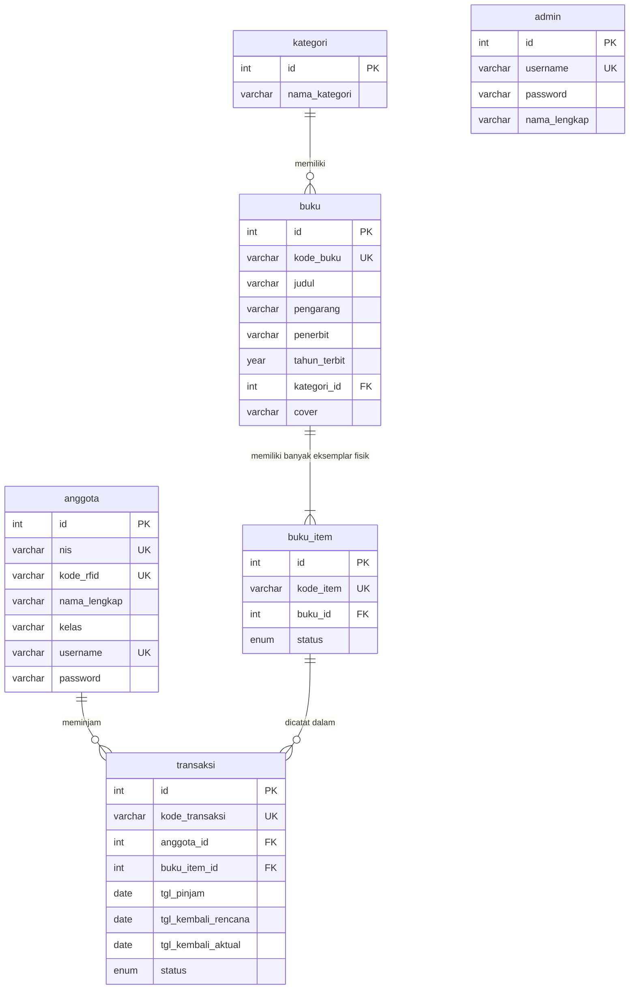

# BUKU SAKU & PANDUAN PRESENTASI UKK RPL
## SISTEM PERPUSTAKAAN DIGITAL — PINJAM.IN
**Penyusun:** Muhammad Farid Malik  
**Program Keahlian:** Rekayasa Perangkat Lunak (RPL)  
**Tahun:** 2026 / 2027  

---

## 1. Ringkasan Singkat Proyek (Elevator Pitch)
> *"Pinjam.In adalah aplikasi perpustakaan sekolah digital berbasis web yang mengintegrasikan kartu pelajar (RFID/NIS) dan QR Code per eksemplar buku fisik untuk mempercepat transaksi di meja sirkulasi, mencegah kehilangan buku, dan memudahkan siswa memantau batas peminjaman secara mandiri."*

### Teknologi yang Digunakan:
* **Backend:** PHP Native (Menggunakan ekstensi **PDO - PHP Data Objects**).
* **Database:** MariaDB / MySQL (XAMPP).
* **Frontend:** HTML5, CSS3 murni, dan Vanilla JavaScript.
* **Keamanan:** Prepared Statements (Anti SQL-Injection), Hashing Password `PASSWORD_BCRYPT`.

---

## 2. Struktur Database & Hubungan Tabel (ERD)

Database proyek ini bernama `pinjam_in` dan memiliki **6 tabel utama**:

### 💡 Jawaban Pintar: Kenapa tabel `buku` dan `buku_item` dipisah?
> **Jawaban ke Penguji:**  
> *"Tabel `buku` mencatat informasi **judul dan penerbit** (katalog), sedangkan tabel `buku_item` mencatat **fisik buku** di rak. Satu judul buku bisa memiliki 5 eksemplar fisik. Masing-masing fisik memiliki kode QR unik (`kode_item`) dan status tersendiri (apakah sedang dipinjam, tersedia, atau rusak)."*

---

## 3. Penjelasan 5 Alur Utama Aplikasi

### ALUR 1: Autentikasi & Multi-Role (Login Admin vs Siswa)
* **File Utama:** `login.php` $\rightarrow$ `config/proses_login.php`
* **Cara Kerja:**
  1. Pengguna memasukkan username & password.
  2. Sistem pertama-tama mengecek ke tabel `admin`. Jika username ditemukan dan `password_verify()` cocok, diset `$_SESSION['admin_id']` lalu diarahkan ke `/admin/dashboard.php`.
  3. Jika bukan admin, sistem mengecek ke tabel `anggota`. Jika cocok, diset `$_SESSION['anggota_id']` lalu diarahkan ke `/siswa/dashboard.php`.
  4. Halaman admin dijaga oleh `config/cek_session_admin.php`, dan halaman siswa dijaga oleh `config/cek_session_siswa.php`. Jika belum login, otomatis mental kembali ke halaman login.

---

### ALUR 2: Pengelolaan Data Buku & Eksemplar Fisik
* **File Utama:** `admin/buku.php` $\rightarrow$ `config/proses_buku.php` & `admin/buku_item.php`
* **Cara Kerja:**
  1. Saat admin menambah judul buku baru dan mengisi "Jumlah Eksemplar Awal = 3", sistem menggunakan **Database Transaction (`beginTransaction`)**.
  2. Pertama, judul buku disimpan ke tabel `buku`.
  3. Sistem mengambil ID buku tersebut (`lastInsertId`), lalu melakukan perulangan (*looping*) untuk membuat 3 baris di tabel `buku_item` dengan format kode `BK-{buku_id}-001`, `BK-{buku_id}-002`, dst.
  4. Setiap eksemplar memiliki tombol **"Cetak QR"** (`config/generate_qr.php`) untuk dicetak jadi stiker fisik.

---

### ALUR 3: Pengelolaan Anggota & Pairing Kartu RFID
* **File Utama:** `admin/anggota.php` $\rightarrow$ `config/proses_anggota.php`
* **Cara Kerja:**
  1. Siswa dapat mendaftar mandiri lewat `daftar.php` atau didaftarkan oleh admin.
  2. Admin dapat menghubungkan kartu fisik RFID siswa melalui menu **"Tap RFID"**: tempelkan kartu pada card reader USB, nomor kartu UID otomatis masuk ke form dan disimpan ke kolom `anggota.kode_rfid`.

---

### ALUR 4: Transaksi Meja Sirkulasi — Peminjaman Buku
* **File Utama:** `admin/peminjaman.php` $\rightarrow$ `config/proses_transaksi_admin.php`
* **Langkah 1 (Scan Siswa):**  
  Admin men-tap kartu RFID siswa (atau ketik NIS). Sistem membaca data siswa dan menyimpannya di session (`admin_scan_anggota_id`).
* **Langkah 2 (Scan Buku):**  
  Admin men-scan QR Code pada buku fisik. Sistem memeriksa 3 validasi:
  * Apakah buku berstatus 'tersedia'?
  * Apakah siswa sudah meminjam judul buku yang sama? (Cegah dobel pinjam judul sama).
  * Apakah siswa sudah mencapai batas kuota maksimal (3 buku)?
* **Langkah 3 (Pencatatan):**  
  Jika semua valid, sistem:
  * Memasukkan data ke tabel `transaksi` dengan `status = 'dipinjam'`, `tgl_pinjam = hari ini`, dan `tgl_kembali_rencana = hari ini + 7 hari`.
  * Mengubah status di `buku_item` menjadi `'dipinjam'`.

---

### ALUR 5: Transaksi Meja Sirkulasi — Pengembalian Buku
* **File Utama:** `admin/pengembalian.php` $\rightarrow$ `config/proses_kembalikan_admin.php`
* **Cara Kerja:**
  1. Admin men-scan kartu siswa. Sistem menampilkan buku-buku yang sedang aktif dipinjam oleh siswa tersebut.
  2. Admin men-scan QR buku yang dikembalikan (atau klik tombol **"Kembalikan"**).
  3. Sistem membandingkan tanggal hari ini dengan `tgl_kembali_rencana`:
     * Jika hari ini $\le$ batas kembali: status diset `'dikembalikan'`.
     * Jika hari ini $>$ batas kembali: status diset `'terlambat'`.
  4. Kolom `tgl_kembali_aktual` diisi tanggal hari ini, dan status di `buku_item` dikembalikan menjadi `'tersedia'` sehingga buku bisa dipinjam siswa lain.

---

## 4. Kamus Konsep & Istilah yang Sering Ditanya Penguji

| Istilah / Kode | Penjelasan Sederhana untuk Penguji |
|---|---|
| **PDO (PHP Data Objects)** | Antarmuka ekstensi PHP untuk berkomunikasi dengan database. Keunggulannya lebih aman, modern, dan mendukung berbagai jenis RDBMS (MySQL, PostgreSQL, dll). |
| **Prepared Statement** | Teknik pemisahan query SQL dengan data input menggunakan placeholder `:nama`. Mencegah karakter manipulasi SQL Injection karena data diperlakukan murni sebagai nilai, bukan perintah. |
| **`password_hash()`** | Fungsi enkripsi satu arah (*one-way hash*) berbasis algoritma Bcrypt dengan *salt* acak otomatis. Password tidak bisa dibaca balik oleh siapa pun. |
| **`password_verify()`** | Fungsi PHP untuk mencocokkan password teks biasa dari form login dengan hash acak di database tanpa harus men-dekripsi hash tersebut. |
| **`beginTransaction()` & `commit()`** | Fitur transaksi atomik database. Memastikan beberapa query yang berkaitan (misal: tambah transaksi + ubah status buku) wajib berhasil semua. Jika salah satu error, sistem melakukan `rollBack()` agar data tidak rusak. |
| **`session_start()`** | Memulai penyimpanan data sementara di server untuk mengingat status pengguna yang sedang login di seluruh halaman. |
| **`htmlspecialchars()`** | Fungsi pembersih output teks untuk mencegah celah **XSS (Cross-Site Scripting)** agar kode script HTML jahat tidak dieksekusi browser. |

---

## 5. Simulasi Tanya Jawab Ujian UKK (FAQ Penguji)

### Q1: *"Farid, coba jelaskan kenapa kamu memilih PHP Native tanpa framework?"*
> **Jawaban:**  
> *"Saya menggunakan PHP Native dengan pendekatan modular dan PDO agar saya benar-benar memahami dasar arsitektur web: bagaimana sesi bekerja, alur autentikasi, serta manipulasi basis data dengan query terparameterisasi tanpa tersembunyi di balik magic function framework. Kode ini juga sangat ringan dan dapat berjalan di server sekolah mana pun tanpa dependency tambahan."*

### Q2: *"Bagaimana aplikasi kamu melindungi diri dari serangan SQL Injection?"*
> **Jawaban:**  
> *"Seluruh query yang menerima input dari user (baik POST maupun GET) menggunakan PDO Prepared Statement dengan metode `prepare()`, `bindParam()`, atau `bindValue()`. Tidak ada penggabungan string query langsung seperti `WHERE user = '$user'`, sehingga hacker tidak bisa menyisipkan injeksi SQL."*

### Q3: *"Apa yang terjadi jika siswa meminjam buku tapi listrik mati di tengah proses transaksi?"*
> **Jawaban:**  
> *"Saya menggunakan mekanisme Database Transaction (`beginTransaction()`, `commit()`, dan `rollBack()` di blok `try-catch`). Jika insert transaksi berhasil tetapi update status buku gagal atau terputus, seluruh perubahan otomatis dibatalkan (`rollBack`), sehingga tidak ada data menggantung."*

### Q4: *"Kenapa kode QR dibuat per eksemplar fisik, bukan per judul buku?"*
> **Jawaban:**  
> *"Karena di perpustakaan nyata, satu judul bisa memiliki banyak buku fisik. Jika kode QR-nya sama, petugas tidak tahu eksemplar nomor berapa yang hilang atau sedang dipinjam. Dengan QR unik per eksemplar, perpustakaan dapat melacak fisik buku secara presisi."*

### Q5: *"Bagaimana sistem menghitung apakah pengembalian buku terlambat atau tidak?"*
> **Jawaban:**  
> *"Saat dipinjam, sistem menentukan `tgl_kembali_rencana = date('Y-m-d', strtotime('+7 days'))`. Saat buku dikembalikan, sistem membandingkan `date('Y-m-d')` dengan `tgl_kembali_rencana`. Jika tanggal hari ini lebih besar, selisih harinya dihitung dengan `(strtotime(today) - strtotime(rencana)) / 86400`, dan status transaksi dicatat sebagai 'terlambat'."*

---

💡 **Tips Tambahan Saat Ujian:**  
1. Saat ditanya kode, buka file yang sesuai panduan di atas.
2. Fokus jelaskan **alurnya** (Input $\rightarrow$ Validasi $\rightarrow$ SQL $\rightarrow$ Hasil), penguji paling suka siswa yang paham alur logika sistemnya!

